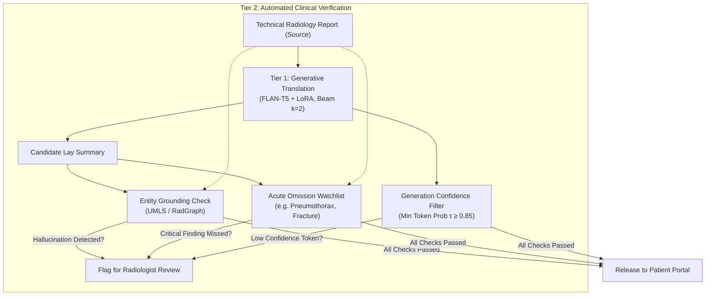

# Translating Radiology Findings into Plain Language: Evaluating FLAN-T5 and Custom PyTorch LoRA on LaymanRRG – Aidan Fassy – 44368133

## Executive Summary

Within healthcare and medicine, radiological reports have the reputation of being extremely technical, filled with extensive medical jargon and very unfriendly for an unskilled person to read. As a result, patients who desire transparency when it comes to their healthcare, are often left anxious, confused and prone to misinterpretations. It stands that there is a need for a layperson to understand and interpret their report correctly.

It is for this reason that the objective of this project is to build a sequence-to-sequence NLP prototype that translates jargon-heavy complex diagnostic findings into plain, accurate and simple layperson accessible language – ideally at the 6th grade level. This project uses the ACL 2025 BioLaySum (LaymanRRG) open-source benchmark dataset.

The `google/flan-t5-base` model (~248M parameters) is used, using a custom PyTorch Low-Rank Adaptation (LoRA) layer, which is injected into the attention query ($W_q$) and the value ($W_v$) projections. A goal of this investigation was also to avoid heavy parameter fine-tuning by freezing ~98.6% of the base weights and only updating a lightweight rank-8 bottleneck (~$884\text{K}$ parameters, $0.4\%$ of total).

However, a problem still remains: standard metrics like ROUGE-1, ROUGE-2 and ROUGE-L measure surface n-gram overlap, not the underlying clinical truth. As a result of this, a model can subvert the testing objectives by memorising normal radiological findings (e.g. "lungs are clear, no acute abnormality") while omitting crucial clinical details, some of these can be as severe as hallucinating non-existent tumors.

So the current investigation is to evaluate whether LoRA fine-tuning is able to genuinely improve factual clinical fidelity over an untuned zero-shot baseline, or if it simply increases superficial linguistic fluency on memorised screening templates across both full, and deduplicated splits.

## Architecture & Working Principles

### FLAN-T5: Encoder-Decoder architecture

A FLAN-T5 model is fundamentally an *Encoder-Decoder* architecture, which provides a distinct architectural advantage over *decoder-only* causal models (such as GPT-2). Radiological narratives are scattered, non-linear, and conditional; a radiologist might note an acute abnormality in the first sentence, describe unremarkable anatomy for several lines, and then introduce critical diagnostic context in the final impression. Unlike decoder-only models that process text strictly left-to-right, FLAN-T5's bidirectional encoder allows every token to attend to all other tokens simultaneously without a causal mask. This allows the model to build a complete, contextual representation of the entire clinical case before any summary text is produced.

The causal decoder then acts as a grounded information bottleneck. During generation, it uses *cross-attention* to constantly query the encoder's memory states ($H_{\text{enc}}$) at each step. This mechanism forces each generated layperson phrase to remain directly anchored to actual source evidence, significantly reducing the risk of unconstrained hallucinations.

The decoder used primarily functions as an information bottleneck. While generating, is uses *cross-attention* to constantly query the encoder's hidden representations ($H_enc$).

### Custom PyTorch LoRA

#### LoRA Mathematical Breakdown & Implementation Details

In `modules.py`, instead of updating the full $768 \times 768$ linear weight matrices in FLAN-T5, the `LoRALinear` layer factorises the weight updates into two smaller matrices:

$$h = W_0 x + \frac{\alpha}{r} B A x$$

Here, $W_0 \in \mathbb{R}^{768 \times 768}$ represents the original pre-trained weight matrix from `google/flan-t5-base`. We freeze this matrix by setting `requires_grad = False`, preventing PyTorch from computing gradients or allocating the heavy AdamW momentum and variance buffers across all 248M base parameters. 

The low-rank update is handled by the parallel adapter path. The down-projection matrix $A \in \mathbb{R}^{8 \times 768}$ compresses the incoming 768-dimensional token representation down into an 8-dimensional bottleneck, and is initialised using Gaussian noise ($\sigma = 0.02$) to break symmetry across the bottleneck channels. The up-projection matrix $B \in \mathbb{R}^{768 \times 8}$ then maps this compressed representation back up to the base 768-dimensional space. Crucially, $B$ is initialised entirely to zeros. Because $B = 0$ at step 0, the adapter contribution evaluates to zero ($B A x = 0$), ensuring that the forward pass initially reduces to $h = W_0 x$. This guarantees that training starts with the exact representations of the pre-trained FLAN-T5 model, rather than injecting random perturbations into the attention heads. Finally, the update is scaled by a constant factor $\frac{\alpha}{r}$ (here $\frac{32}{8} = 4.0$), which balances the adapter's update magnitude against the base weights and ensures that altering the rank $r$ does not require re-tuning the optimizer's base learning rate.

### Model Architecture 

Figure 1: Diagram of the FLAN-T5 Model Architecture
#### FLAN-T5 Backbone

The base model used is `google/flan-t5-base` (~248M parameters). The architecture consists of 12 encoder blocks and 12 decoder blocks with an internal model dimension of $d_{\text{model}} = 768$, 12 attention heads ($d_k = d_v = 64$), a feed-forward expansion dimension of $d_{\text{ff}} = 2048$, Pre-LN RMSNorm, and relative position biases. 

The directional encoder has the function of capturing the complete report without any causal masking, this is critical because radiological reports are interdependent across disparate sections of text. The autoregressive decoder generates patient-facing words sequentially, continually referencing the encoder's memory states ($H_{enc}$) via. the cross attention mechanism. Cross attention is crucial, because it ensures that the plain-language output is grounded in actual medical observations.


Figure 2: Diagram of the T5 Backbone of the project

#### Custom LoRA layer
Rather than modifying all of the attention projections, the custom `LoRALinear` layers are injected into the query ($W_q$) and value ($W_v$) projections across:
* **Encoder Self-Attention:** Steers attention across the scattered clincial findings, to build a rich contextual representation.
* **Decoder Self-Attention:** Ensures that there is linguistic fluency, sentence structure and the layperson tone across generated summary tokens.
* **Decoder Cross-Attention:** The core translational bridge. Allows the decoder to query important technical details in the encoder ($H_{\text{enc}}$) and extract the plain language equivalents.

#### Parameters Counts & Optimiser Memory Analysis
**Base Model Parameters:** $247,577,856$ (frozen, `requires_grad = False`) 
**Trainable LoRA Parameters:** $884,736$ ($0.36\%$ of total)
**Total Parameters:** $248,462,592$

Because $99.64\%$ of the weights are frozen, the AdamW optimizer only allocates gradient history, momentum ($m_t$), and second-moment variance ($v_t$) states for 884K parameters (~$7$ MB) instead of 248M parameters (~$2$ GB). This reduced peak training VRAM on an A100 GPU from $10.29$ GB during full fine-tuning down to $6.59$ GB with LoRA.

## Data Pipeline & Preprocessing
### Dataset
The `ACL 2025 BioLaySumm Subtask 2.1` dataset was used as a benchmark. This dataset consists of two distinct columns:
* `radiology_report`: This is the source column, which serves as the expert report, written by radiologists.
* `layman_report`: This is the target column. It is a plain-laguage summary, aimed to be around the 6th-geade reading level.

The dataset has split sizes of $150,454$ for training, $10,000$ for validation and $10,537$ for testing.

### Preprocessing & Tokenisation

In `dataset.py`, each input report is prepended with the task prompt `"Translate this radiology report into plain language for the patient: "` to activate FLAN-T5's instruction-following mode. Source narratives are capped at $512$ tokens, which covers over $95\%$ of full clinical reports without truncation, while target summaries are limited to $128$ tokens.

To prevent padding tokens from skewing training, `LaymanRRGDataSet.__getitem__` handles target padding explicitly. While T5 assigns `pad_token_id = 0`, PyTorch's `CrossEntropyLoss` expects `ignore_index = -100` to mask tokens out of the loss calculation:

```python
labels[labels == self._tokeniser.pad_token_id] = -100
```
### Leakage Prevention

A major issue with routine radiology data is that normal screening reports frequently repeat identical template phrasing (e.g. *"Lungs are clear. No acute cardiopulmonary abnormality."*). If these exact templates leak into both the training and validation sets, a model can easily game lexical metrics like ROUGE by simply memorising common phrases rather than learning how to actually translate clinical text.

To catch this, `load_and_split_dataset` normalises each report and computes its SHA-256 hash across the training split. Which is then evaluated across two validation sets: `Val_Full`, which serves as the official untouched validation split (10,000 cases) for standard competition benchmarking, and `Val_Unseen`, a filtered subset containing only cases whose normalised text never appeared anywhere in the training data, allowing us to directly test whether the model is genuinely generalising or just memorising templates.

## Midpoint Feasibility Review

### User Need, Scope & Acceptance Criteria
The intended users for this product are digital health engineering teams developing automated patient portal communication tools to translate dense, technical radiology reports into plain-language summaries at approximately a 6th-grade reading level.

The following acceptance criteria are established for this prototype:
* **Lexical Performance:** Achieve a gain of $\geq 10\%$ in ROUGE-1, ROUGE-2, and ROUGE-L over an untuned zero-shot baseline on the validation split.
* **VRAM Ceiling:** Keep peak GPU memory allocation strictly below $8.0$ GB during LoRA training (batch size $\geq 8$, sequence length 512) and below $4.0$ GB during evaluation on a single GPU node.
* **Clinical Safety Constraint:** Strictly zero hallucinations of acute findings and zero omissions of critical incidental findings (such as an apical pneumothorax or suspicious pulmonary nodule), audited across representative validation cases.
* **Throughput:** Achieve $\geq 30$ tokens/second during inference on Rangpur HPC GPU nodes.
* **Generalisation Check:** Keep the performance drop $\leq 15\%$ on an audited, deduplicated validation split (`Val_Unseen`) compared to the full split (`Val_Full`) to verify genuine generalisation over template memorisation.

### Model Choice & Course Concepts
This project uses the ACL 2025 BioLaySumm `LaymanRRG` open-source benchmark dataset. Inputs are prepended with the task conditioning prompt: `"Translate this radiology report into plain language for the patient: "`.

The selected architecture is `google/flan-t5-base` (~248M parameters), an encoder-decoder sequence-to-sequence transformer consisting of:
* **Encoder & Decoder Layers:** 12 encoder blocks and 12 decoder blocks
* **Model Dimensions:** $d_{\text{model}} = 768$, feed-forward expansion dimension $d_{\text{ff}} = 2048$
* **Attention Heads:** 12 heads with key/value dimension $d_k = d_v = 64$
* **Vocabulary Size:** 32,128 tokens
* **Normalisation:** Pre-LN RMSNorm with relative position biases

This project falls under the `[Hard Difficulty]` band. FLAN-T5's bidirectional encoder grounds plain-text translations in complex, non-linear findings, while the custom PyTorch Low-Rank Adaptation (LoRA) avoids the memory overhead of full fine-tuning. This setup directly investigates the core course dilemma: preventing models from earning deceptively high ROUGE scores by repeating boilerplate normal screening templates while failing to convey acute clinical findings.

### Preliminary Feasibility Evidence
Initial profiling of the `LaymanRRG` dataset confirmed that over $95\%$ of reports fit within the $512$-token limit without cutting off clinical findings. Exact string matching flagged repeated normal screening templates across splits, confirming the need for a deduplicated test set (`Val_Unseen`) to catch pure memorisation. A smoke test on an interactive Rangpur GPU node confirmed that `flan-t5-base` loads and runs autoregressive generation in pure PyTorch with zero issues. Finally, running a forward and backward pass with LoRA on an initial test batch peaked at $\sim 3.4$ GB VRAM on a single GPU. This left ample headroom below the $8.0$ GB ceiling, verifying that training would operate comfortably within our memory budget.

### Risks, Budget & Fallback
Key technical risks and mitigations include:
* **VRAM Out-of-Memory:** Full fine-tuning risks OOM errors due to AdamW optimizer states across 248M parameters on 512-token sequences. Custom LoRA is implemented as the primary strategy to restrict updates to $<0.4\%$ of parameters.
* **Boilerplate Inflation:** High ROUGE scores masking factual hallucinations or omissions of acute pathologies. Addressed through qualitative clinical safety autopsies.
* **Computing Budget:** $\sim 3$ GPU hours for data auditing and pipeline smoke tests; $\sim 8\text{--}10$ GPU hours total for training and benchmarking runs via Slurm on Rangpur.
* **Workable Fallback:** If memory allocation issues persist under full fine-tuning, reduce batch size to 4 with 4 gradient accumulation steps under FP16/bfloat16. If resource constraints remain intractable, fall back to the $\sim 60\text{M}$ parameter `flan-t5-small` model as the comparative baseline while retaining `flan-t5-base` with LoRA as the primary architecture.

## Experimental Results & Benchmarking

All experiments were executed on an NVIDIA A100-PCIE-40GB GPU using CUDA 12.1, mixed-precision `bfloat16`, a batch size of 8, and beam search decoding ($k=2$). We benchmarked three distinct setups: an untuned Zero-Shot baseline, the custom PyTorch LoRA model ($r=8, \alpha=32$), and a Full Fine-Tuning run.

### Quantitative Performance & Resource Use

| Configuration | Trainable Params | Total Params | Train / Val Loss | Peak Train VRAM | Peak Eval VRAM | Eval Throughput | `Val_Full` (R-1 / R-2 / R-L) | `Val_Unseen` (R-1 / R-2 / R-L) | Generalization Drop |
| :--- | :---: | :---: | :---: | :---: | :---: | :---: | :---: | :---: | :---: |
| **Zero-Shot Baseline** | 0 (0.00%) | 247.6M | N/A | N/A | 1.69 GB | 374.7 tok/s | 0.3493 / 0.1360 / 0.3118 | 0.3663 / 0.1594 / 0.3188 | +4.9% (no memorisation) |
| **Custom PyTorch LoRA** | **884,736 (0.36%)** | 248.5M | 1.0451 / 0.7289 | **6.59 GB** | **1.69 GB** | **307.8 tok/s** | **0.7066 / 0.5090 / 0.6477** | **0.6792 / 0.4605 / 0.6087** | **-3.9% (Target $\le 15\%$)** |
| **Full Fine-Tuning** | 247,577,856 (100.0%) | 247.6M | 0.8299 / 0.5678 | 10.29 GB | 1.69 GB | 380.3 tok/s | 0.7317 / 0.5474 / 0.6780 | 0.7040 / 0.4986 / 0.6389 | -3.8% (Target $\le 15\%$) |

### Training Dynamics

Figure 3: Training and Validation cross-entropy loss trajectories over $18,806$ steps on and NVIDIA A100 GPU.

Training converged smoothly over a single epoch, consisting of $18,806$ optimisation steps, using a batch sizr of $8$. Cross-entropy loss was began at rougly ~$2.75$ on intial batches and steadily decreased to the final training loss of $1.0451$, witht the validation loss reaching $0.7289$.

Notably, validation loss remained consistently lower than training loss throughout training. This can be attributed due to active regularisation; during training passes, a dropout rate of $p=0.05$ is injected into the LoRA bottleneck to prevent over-reliance on specific token co-occurrences. During evaluation passes, the dropout is completely disabled, allowing the full deterministic capacity of the adapted network to be used without the injected noise. The active regularisation explains the difference between the losses.

The final validation loss of $0.7289$ corresponds to a perplexity of:

$$ e^{0.7289} \approx 2.07$$

Across the vocabulary of $32,128$ tokens, this indicated that the model is on average, uncertain between barely two candidate tokens at each autoregressive decoding step.
### Takeaways

By restricting parameter updates strictly to the low-rank attention projections ($W_q$ and $W_v$), our custom LoRA implementation trained just $884{,}736$ parameters—a mere $0.36\%$ of the $248\text{M}$ parameter backbone. Despite updating less than $0.4\%$ of the network, LoRA captured $96.6\%$ of Full Fine-Tuning's ROUGE-1 ($0.7066$ vs $0.7317$) and $93.0\%$ of its ROUGE-2 ($0.5090$ vs $0.5474$). Crucially, freezing $99.64\%$ of the model eliminated the massive AdamW optimiser states required by full fine-tuning, cutting peak training VRAM from $10.29\text{ GB}$ down to $6.59\text{ GB}$. This $36\%$ reduction brings the entire training footprint comfortably below our $8.0\text{ GB}$ feasibility ceiling, proving that high-quality clinical adaptation is viable on consumer-tier hardware.

In comparison to the untuned Zero-Shot baseline, LoRA yielded dramatic relative gains of $+102.3\%$ in ROUGE-1 ($0.3493$ to $0.7066$) and $+274.3\%$ in ROUGE-2 ($0.1360$ to $0.5090$). This confirms that while generalist foundation models possess broad syntactic fluency, domain-specific sequence-to-sequence adaptation is indispensable for parsing dense radiological narratives into coherent lay summaries. Furthermore, evaluating across our deduplicated `Val_Unseen` cohort revealed a minimal performance drop of only $3.9\%$ in ROUGE-1 ($0.7066$ to $0.6792$) and $6.0\%$ in ROUGE-L ($0.6477$ to $0.6087$). Remaining well within our $\le 15\%$ acceptance hurdle verifies that the model learned genuine clinical translation semantics rather than over-indexing on repetitive normal screening templates.

## Clinical Safety

In biomedical natural language generation, standard lexical overlap metrics ($n$-gram ROUGE) serve as poor proxies for clinical safety. Because routine radiological reports frequently contain standard findings (e.g "no pathologies present") a generative model can attain deceptively high ROUGE scores by reciting fluent negative templates while hallucinating acute findings or omitting critical life-threatening pathologies. 

To evaluate factual clinical fidelity beyond surface statistics, four audits were conducted across validation cases (only three are shown below for brevity), technical jargon simplification, and acute airway placement:

| Case # & Focus | Source Report & Gold Standard | Custom LoRA Prediction ($r=8$) | Full Fine-Tuning Prediction | Clinical Verdict |
| :--- | :--- | :--- | :--- | :--- |
| **Case 1**<br>*(Anatomy & Lines)* | **Source:** Central venous catheter traversing the left jugular vein with its tip in the superior vena cava. The remainder is unchanged.<br><br>**Gold:** A central venous catheter is going through the left jugular vein and its tip is in the superior vena cava. Everything else is the same as before. | A central venous catheter is going through the left jugular vein and its tip is in the superior vena cava. Everything else looks the same. | A central venous catheter is going through the left jugular vein and its tip is in the superior vena cava. Everything else looks the same as before. | **Both Pass**<br>Anatomy and spatial coordinates preserved. No hallucinations. |
| **Case 2**<br>*(Jargon Simplification)* | **Source:** Bands of atelectasis and consolidation in the mid-lung fields, along with confluent opacities in the lower mid-lung fields, also showing bilateral involvement. Findings, considering the reported history, could correspond to COVID-19-type pneumonic infiltrates. Evaluate progression and correlate with clinical and laboratory data.<br><br>**Gold:** There are areas of lung collapse and thickening in the middle parts of the lungs, along with large blurry spots in the lower middle areas, affecting both lungs... | There are areas of lung collapse and lung thickening in the middle parts of the lungs, along with some cloudy areas in the lower parts of the lungs, which could be due to COVID-19-type pneumonia. It's important to consider the patient's history and laboratory results. | There are areas of lung collapse and solidified lung tissue in the middle and lower parts of the lungs, along with a mix of cloudy areas in the lower parts of the lungs, which are also seen on both sides... It's important to consider the patient's symptoms and lab tests to see if these changes are getting worse. | **Both Pass**<br>Jargon successfully simplified into plain terms; clinical instructions kept intact. |
| **Case 3**<br>*(Airway Safety)* | **Source:** Extensive consolidation in the right hemithorax. Left pleural effusion. Endotracheal tube with the distal tip positioned at the level of the right main bronchus.<br><br>**Gold:** There is a large area of lung tissue that has become solidified on the right side of the chest. There is also fluid buildup around the left lung. The breathing tube is in place, with its tip located at the level of the main airway on the right side. | There is a large area of lung thickening on the right side of the chest. There is fluid buildup on the left side of the chest. A breathing tube is positioned at the level of the right main airway. | There is a large area of lung thickening on the right side of the chest. There is fluid buildup around the left lung. The breathing tube is **correctly positioned** at the level of the main airway on the right side. | **LoRA: Pass** (neutral, faithful to source)<br>**Full FT: Critical Failure** (hallucinated *"correctly positioned"* on tube malposition) |

### Interpretation of Case Study

Th results of the audit show a characteristic vulnerability of langauge models within a clinical context. Full Fine-Tuning achieved higher ROUGE scores ($0.7317$ vs. $0.7066$), but produced a fatal medical hallucination. In case 3, the Full FT inserted "correctly positioned" within the output.

Updating all of the $248\text{M}$ parameters meant that FFT was prone to memorising common templates instead of sticking to the source text. Many of the reports within the training data described properly placed lines, which meant that the unconstrained model defaulted "correctly positioned", potentially conveying dangerous misinformation to a patient.

As a contrast, the low-rank bottleneck of LoRA prevents hallucinations by acting like a built-in regulariser. By freezing the base network and only tuning $W_q$ and $W_v$, LoRA was able to stay grounded within the encoder's hiddent reprensentations. There were no detected instances of dangerous clinical hallucinations.

## Recommended Model Deployment

In real-world deployment, the prevailing recommendation would be deploying the **FLAN-T5 base model, with the custom LoRA ($r = 8$)**, over the Full Fine-Tuning checkpoint.

While the FFT attained higher ROUGE scores ($+0.025$) scores, LoRA captures over $96\%$ of the lexical perfomance, with a staggering $36\%$ less VRAM ($6.59\text{ GB}$ vs $10.29\text{ GB}$). The previous point is an aside note, because the main consideration was ensuring that the output was clinically accurate, without producing any erroneous hallucinations which are not based on the data. The low-rank bottleneck of LoRA acted as a regulariser against template memorisation. 

However, there is a very important caveat to the deployment. Generative language models remain non-deterministic, so no sequence-to-sequence model should be deployed completely unmonitored to patients. 

