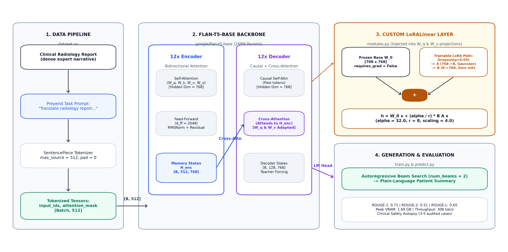
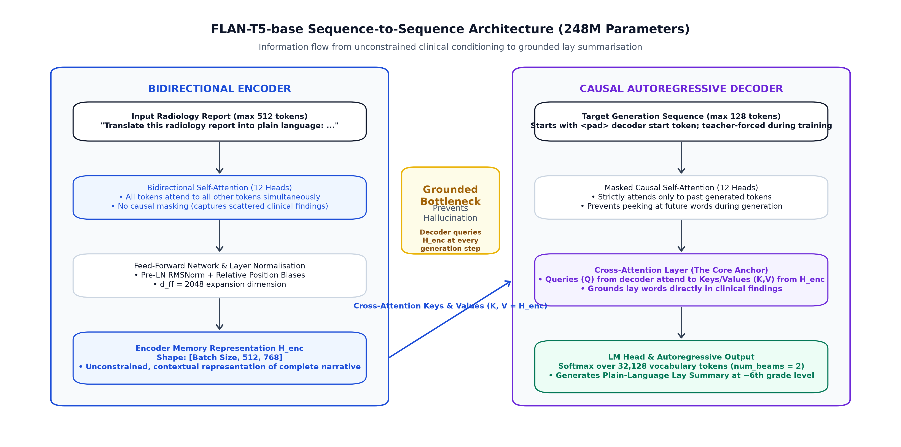

# Translating Radiology Findings into Plain Language: Evaluating FLAN-T5 and Custom PyTorch LoRA on LaymanRRG – Aidan Fassy – 44368133

## Executive Summary

Within healthcare and medicine, radiological reports have the reputation of being extremely technical, filled with extensive medical jargon and very unfriendly for an unskilled person to read. As a result, patients who desire transparency when it comes to their healthcare, are often left anxious, confused and prone to misinterpretations. It stands that there is a need for a layperson to understand and interpret their report correctly.

It is for this reason that the objective of this project is to build a sequence-to-sequence NLP prototype that translates jargon-heavy complex diagnostic findings into plain, accurate and simple layperson accessible language – ideally at the 6th grade level. This project uses the ACL 2025 BioLaySum (LaymanRRG) open-source benchmark dataset.

The `google/flan-t5-base` model (~248M parameters) is used, using a custom PyTorch Low-Rank Adaptation (LoRA) layer, which is injected into the attention query ($W_q$) and the value ($W_v$) projections. A goal of this investigation was also to avoid heavy parameter fine-tuning by freezing ~98.6% of the base weights and only updating a lightweight rank-8 bottleneck (~$884\text{K}$ parameters, $0.4\%$ of total).

However, a problem still remains: standard metrics like ROUGE-1, ROUGE-2 and ROUGE-L measure surface n-gram overlap, not the underlying clinical truth. As a result of this, a model can subvert the testing objectives by memorising normal radiological findings (e.g. "lungs are clear, no acute abnormality") while omitting crucial clinical details, some of these can be as severe as hallucinating non-existent tumors.

So the current investigation is to evaluate whether LoRA fine-tuning is able to genuinely improve factual clinical fidelity over an untuned zero-shot baseline, or if it simply increases superficial linguistic fluency on memorised screening templates across both full, and deduplicated splits.

## Architecture & Working Principles

- Explain Encoder-Decoder architecture, and why its used

**Still to do: Why is there an advantage over decoder only???**
### FLAN-T5: Encoder-Decoder architecture

A FLAN-T5 is fundamentally an *Encoder-Decoder* architecture, and subsequently has a huge architectural advantage over *decoder-only* causal models (e.g. GPT-2). Findings in radiological reports are scattered, non-linear and conditional, radiologists may mention an acute finding in a single sentence, describe normal anatomy for three, and then add crucial context in the last sentence – this means that each sentence isn't necessarily weighed equally.

Within FLAN-T5, a bidirectional encoder is used – with every token attending to every other token simultaneously, with no causal attention mask. This allows for the encoder to build a detailed contextual repreentation of the entire clinical narrative, before anything of substance is generated.

The decoder used primarily functions as an information bottleneck. While generating, is uses *cross-attention* to constantly query the encoder's hidden representations ($H_enc$).

### Custom PyTorch LoRA

#### LoRA Mathematical Breakdown & Implementation Details

In `modules.py`, instead of updating the full $768 \times 768$ linear weight matrices in FLAN-T5, the `LoRALinear` layer factorises the weight updates into two smaller matrices:

$$h = W_0 x + \frac{\alpha}{r} B A x$$

Here, $W_0 \in \mathbb{R}^{768 \times 768}$ represents the original pre-trained weight matrix from `google/flan-t5-base`. We freeze this matrix by setting `requires_grad = False`, preventing PyTorch from computing gradients or allocating the heavy AdamW momentum and variance buffers across all 248M base parameters. 

The low-rank update is handled by the parallel adapter path. The down-projection matrix $A \in \mathbb{R}^{8 \times 768}$ compresses the incoming 768-dimensional token representation down into an 8-dimensional bottleneck, and is initialised using Gaussian noise ($\sigma = 0.02$) to break symmetry across the bottleneck channels. The up-projection matrix $B \in \mathbb{R}^{768 \times 8}$ then maps this compressed representation back up to the base 768-dimensional space. Crucially, $B$ is initialised entirely to zeros. Because $B = 0$ at step 0, the adapter contribution evaluates to zero ($B A x = 0$), ensuring that the forward pass initially reduces to $h = W_0 x$. This guarantees that training starts with the exact representations of the pre-trained FLAN-T5 model, rather than injecting random perturbations into the attention heads. Finally, the update is scaled by a constant factor $\frac{\alpha}{r}$ (here $\frac{32}{8} = 4.0$), which balances the adapter's update magnitude against the base weights and ensures that altering the rank $r$ does not require re-tuning the optimizer's base learning rate.

### Model Architecture 

Figure 1: Diagram of the FLAN-T5 Model Architecture
#### FLAN-T5 Backbone

The base model used is `google/flan-t5-base` (~248M parameters). The architecture consists of 12 encoder blocks and 12 decoder blocks with an internal model dimension of $d_{\text{model}} = 768$, 12 attention heads ($d_k = d_v = 64$), a feed-forward expansion dimension of $d_{\text{ff}} = 2048$, Pre-LN RMSNorm, and relative position biases. 

The directional encoder has the function of capturing the complete report without any causal masking, this is critical because radiological reports are interdependent across disparate sections of text. The autoregressive decoder generates patient-facing words sequentially, continually referencing the encoder's memory states ($H_{enc}$) via. the cross attention mechanism. Cross attention is crucial, because it ensures that the plain-language output is grounded in actual medical observations.



#### Custom LoRA layer
Rather than modifying all of the attention projections, the custom `LoRALinear` layers are injected into the query ($W_q$) and value ($W_v$) projections across:
* **Encoder Self-Attention:** Steers attention across the scattered clincial findings, to build a rich contextual representation.
* **Decoder Self-Attention:** Ensures that there is linguistic fluency, sentence structure and the layperson tone across generated summary tokens.
* **Decoder Cross-Attention:** The core translational bridge. Allows the decoder to query important technical details in the encoder ($H_{\text{enc}}$) and extract the plain language equivalents.

#### Parameters Counts & Optimiser Memory Analysis
**Base Model Parameters:** $247,577,856$ (frozen, `requires_grad = False`) 
**Trainable LoRA Parameters:** $884,736$ ($0.36\%$ of total)
**Total Parameters:** $248,462,592$

Because $99.64\%$ of the weights are frozen, the AdamW optimizer only allocates gradient history, momentum ($m_t$), and second-moment variance ($v_t$) states for 884K parameters (~$7$ MB) instead of 248M parameters (~$2$ GB). This reduced peak training VRAM on an A100 GPU from $10.29$ GB during full fine-tuning down to $6.59$ GB with LoRA.

## Data Pipeline & Preprocessing
### Dataset
The `ACL 2025 BioLaySumm Subtask 2.1` dataset was used as a benchmark. This dataset consists of two distinct columns:
* `radiology_report`: This is the source column, which serves as the expert report, written by radiologists.
* `layman_report`: This is the target column. It is a plain-laguage summary, aimed to be around the 6th-geade reading level.

The dataset has split sizes of $150,454$ for training, $10,000$ for validation and $10,537$ for testing.

### Preprocessing & Tokenisation
In `dataset.py`, each input report is prepended with the task prompt `"Translate this radiology report into plain language for the patient: "` to activate FLAN-T5's instruction-following mode. Source narratives are capped at $512$ tokens, which covers over $95\%$ of full clinical reports without truncation, while target summaries are limited to $128$ tokens.

To prevent padding tokens from skewing training, `LaymanRRGDataSet.__getitem__` handles target padding explicitly. While T5 assigns `pad_token_id = 0`, PyTorch's `CrossEntropyLoss` expects `ignore_index = -100` to mask tokens out of the loss calculation:

```python
labels[labels == self._tokeniser.pad_token_id] = -100
```
### Leakage Prevention

A major issue with routine radiology data is that normal screening reports frequently repeat identical template phrasing (e.g. *"Lungs are clear. No acute cardiopulmonary abnormality."*). If these exact templates leak into both the training and validation sets, a model can easily game lexical metrics like ROUGE by simply memorising common phrases rather than learning how to actually translate clinical text.

To catch this, `load_and_split_dataset` normalises each report and computes its SHA-256 hash across the training split. Which is then evaluated across two validation sets: `Val_Full`, which serves as the official untouched validation split (10,000 cases) for standard competition benchmarking, and `Val_Unseen`, a filtered subset containing only cases whose normalised text never appeared anywhere in the training data, allowing us to directly test whether the model is genuinely generalising or just memorising templates.

## Feasibility Review
Still to insert here.
## Experimental Results & Benchmarking
## Clinical Safety
## Model Deployment Recommendations